# TECHNICAL ARCHITECTURE SPECIFICATION
## Arabic Language & Cultural Club Platform

### 1. Technology Stack Architecture

```
+-----------------------------------------------------------------------------------+
|                              Client Layer (Browser)                               |
|   - Next.js App Router (React 19 / Server & Client Components)                    |
|   - Tailwind CSS + Semantic Theme Tokens (Light / Dark)                           |
|   - Typography: Manrope / Inter / Noto Naskh Arabic (RTL Aware)                   |
|   - Interaction & Motion: Framer Motion / Lucide Icons / Custom Islamic Patterns   |
+-----------------------------------------------------------------------------------+
                                        |
                                        v
+-----------------------------------------------------------------------------------+
|                        Application & Server Layer (Next.js)                       |
|   - Route Handlers & Server Actions (`app/(public)` & `app/admin`)                |
|   - Server-Side Role-Based Authorization Guard (Middleware & Action Checks)       |
|   - Input Validation (Zod Schemas) & Rate Limiting                                |
|   - Internationalization (i18n) Engine (Dynamic RTL / LTR switching)              |
+-----------------------------------------------------------------------------------+
                                        |
                                        v
+-----------------------------------------------------------------------------------+
|                            Data & Persistence Layer                               |
|   - Relational Database: SQLite (Dev/Self-host) / PostgreSQL (Supabase Compatible) |
|   - ORM / Query Builder: Drizzle ORM or Prisma for Type-Safe Queries & Migrations |
|   - File / Media Storage: Local Protected Storage / Supabase Storage S3           |
|   - Session Engine: Secure HTTP-only cookies with JWT / Session Records           |
+-----------------------------------------------------------------------------------+
```

---

### 2. High-Level Directory & File Structure

```
arabic-club/
├── docs/                             # Permanent project specs, roadmaps, audits
│   ├── MASTER_PROJECT_SPEC.md
│   ├── REQUIREMENTS_CHECKLIST.md
│   ├── ARCHITECTURE.md
│   ├── IMPLEMENTATION_ROADMAP.md
│   ├── CONTENT_INVENTORY.md
│   ├── DECISIONS.md
│   └── PHASE_STATUS.md
├── src/
│   ├── app/
│   │   ├── (public)/                 # Public website routes (grouped layout)
│   │   │   ├── page.tsx              # Homepage
│   │   │   ├── about/page.tsx        # About, Mission, Vision, Values
│   │   │   ├── founders/page.tsx     # Founders & Founding History
│   │   │   ├── history/page.tsx      # Timeline & Historical Milestones
│   │   │   ├── leadership/page.tsx   # Current & Former Committees Archive
│   │   │   ├── members/page.tsx      # Public Member Directory
│   │   │   ├── events/
│   │   │   │   ├── page.tsx          # Annual Calendar & Event Listings
│   │   │   │   └── [slug]/page.tsx   # Event Details & Registration
│   │   │   ├── gallery/
│   │   │   │   ├── page.tsx          # Albums Overview
│   │   │   │   └── [slug]/page.tsx   # Album Photos & Lightbox
│   │   │   ├── resources/page.tsx    # Arabic Learning Materials
│   │   │   ├── publications/page.tsx # Achievements & Magazines
│   │   │   ├── membership/page.tsx   # Application Form & Status Tracker
│   │   │   ├── news/page.tsx         # News & Announcements
│   │   │   ├── contact/page.tsx      # Contact Form & Office Info
│   │   │   └── policies/page.tsx     # Privacy, Consent & Accessibility
│   │   ├── admin/                    # Admin CMS portal (isolated layout)
│   │   │   ├── login/page.tsx        # Secure Admin Authentication
│   │   │   ├── page.tsx              # Dashboard Overview & Metrics
│   │   │   ├── pages/page.tsx        # Page Content CMS
│   │   │   ├── founders/page.tsx     # Founders & History CMS
│   │   │   ├── committees/page.tsx   # Terms & Committee Positions CMS
│   │   │   ├── members/page.tsx      # Member Profiles & Status CMS
│   │   │   ├── applications/page.tsx # Membership Application Review
│   │   │   ├── events/page.tsx       # Events & Registrations CMS
│   │   │   ├── gallery/page.tsx      # Photo Albums & Media Uploads
│   │   │   ├── news/page.tsx         # News & Announcements CMS
│   │   │   ├── resources/page.tsx    # Arabic Learning Resources CMS
│   │   │   ├── publications/page.tsx # Publications CMS
│   │   │   ├── users/page.tsx        # Admin Accounts & Role Permissions
│   │   │   ├── settings/page.tsx     # Website Settings & SEO
│   │   │   └── audit-logs/page.tsx   # Immutable Audit Logs
│   │   ├── api/                      # Protected API Endpoints
│   │   ├── layout.tsx                # Root layout with theme & font provider
│   │   └── globals.css               # Heritage design tokens & tailwind rules
│   ├── components/
│   │   ├── ui/                       # Reusable UI primitives (Button, Modal, Card...)
│   │   ├── layout/                   # Header, Footer, AdminSidebar, ThemeToggle...
│   │   ├── home/                     # Homepage narrative sections
│   │   ├── gallery/                  # Lightbox, ImageGrid, AlbumCard
│   │   └── shared/                   # Breadcrumbs, Pagination, LanguageSwitch...
│   ├── lib/
│   │   ├── db/                       # Database client, schemas, migrations
│   │   ├── auth/                     # Authentication & session helpers
│   │   ├── storage/                  # Secure file upload & retrieval handlers
│   │   └── utils/                    # Formatting, date helpers, sanitization
│   └── types/                        # Core TypeScript interfaces & DB types
├── public/                           # Static assets, fallback imagery, patterns
├── tests/                            # Unit, integration, and e2e test suites
├── .env.example                      # Template for environment configuration
└── package.json
```

---

### 3. Database Entity Relationship Diagram (ERD)

The database schema is designed around 18 normalized relational entities:

```mermaid
erDiagram
    SITE_SETTINGS {
        string id PK
        string key UK
        string value_en
        string value_ar
        datetime updated_at
    }
    USERS {
        string id PK
        string email UK
        string password_hash
        string full_name
        string role
        boolean is_active
        datetime created_at
    }
    MEMBERS {
        string id PK
        string membership_id UK
        string full_name_en
        string full_name_ar
        string photo_url
        string email
        string phone
        string student_id
        string status
        boolean is_public
        text bio_en
        text bio_ar
        datetime joined_at
    }
    MEMBERSHIP_APPLICATIONS {
        string id PK
        string reference_no UK
        string applicant_name
        string email
        string phone
        string category
        text motivation
        string status
        text reviewer_notes
        string reviewed_by FK
        datetime created_at
    }
    FOUNDERS {
        string id PK
        string name_en
        string name_ar
        string portrait_url
        string role_title
        text bio_en
        text bio_ar
        integer founding_year
        integer sort_order
    }
    COMMITTEE_TERMS {
        string id PK
        string academic_year UK
        string title_en
        string title_ar
        date start_date
        date end_date
        boolean is_current
        text summary
    }
    COMMITTEE_ASSIGNMENTS {
        string id PK
        string term_id FK
        string member_id FK
        string position_title_en
        string position_title_ar
        integer rank_order
    }
    EVENTS {
        string id PK
        string slug UK
        string title_en
        string title_ar
        text summary_en
        text summary_ar
        string category
        datetime start_time
        datetime end_time
        string venue
        string cover_image_url
        integer capacity
        string status
        boolean registration_open
    }
    EVENT_REGISTRATIONS {
        string id PK
        string event_id FK
        string attendee_name
        string email
        string phone
        string status
        datetime registered_at
    }
    ANNUAL_PLANS {
        string id PK
        string academic_year
        integer month_number
        string activity_title_en
        string activity_title_ar
        string category
        string status
        text notes
    }
    GALLERY_ALBUMS {
        string id PK
        string slug UK
        string title_en
        string title_ar
        text description
        string cover_image_url
        date event_date
        integer year
        boolean is_featured
    }
    MEDIA_ASSETS {
        string id PK
        string album_id FK
        string file_url
        string thumbnail_url
        string caption_en
        string caption_ar
        string credit
        integer sort_order
    }
    LEARNING_RESOURCES {
        string id PK
        string title_en
        string title_ar
        string category
        string skill_level
        string file_url
        text content_ar
        text content_en
        boolean is_published
    }
    PUBLICATIONS {
        string id PK
        string title_en
        string title_ar
        string publication_type
        date publication_date
        string cover_image_url
        string file_url
        text description
    }
    ANNOUNCEMENTS {
        string id PK
        string slug UK
        string title_en
        string title_ar
        text content_en
        text content_ar
        string category
        boolean is_pinned
        boolean is_published
        datetime published_at
    }
    AUDIT_LOGS {
        string id PK
        string user_id FK
        string action
        string target_entity
        string target_id
        text details_json
        datetime created_at
    }

    COMMITTEE_TERMS ||--o{ COMMITTEE_ASSIGNMENTS : contains
    MEMBERS ||--o{ COMMITTEE_ASSIGNMENTS : assigned_to
    EVENTS ||--o{ EVENT_REGISTRATIONS : receives
    GALLERY_ALBUMS ||--o{ MEDIA_ASSETS : stores
    USERS ||--o{ AUDIT_LOGS : performs
```



---

### 4. Security & Authorization Boundaries

1. **Role-Based Access Control (RBAC):**
   - `Super Admin`: Unlimited access across all models, user account creation, system configuration, audit logs.
   - `President / Secretary`: Committee appointments, membership approvals, event confirmations, official notices.
   - `Event Manager`: Event CRUD, registrations list, capacity controls.
   - `Media Manager`: Album creation, image upload, media captions.
   - `Content Editor`: Draft/publish resources, articles, announcements.
2. **Server-Side Enforcement:**
   - Every mutation is secured using a `verifySessionAndPermission(requiredRole)` server-side guard.
   - Database operations use parameterized queries to eliminate SQL injection.
3. **Data Protection & Privacy Boundary:**
   - Public API endpoints filter out sensitive fields (`student_id`, `phone`, `email`, `reviewer_notes`).
   - File uploads are validated by content magic-bytes and MIME types, restricted to approved extensions (`.jpg`, `.jpeg`, `.png`, `.webp`, `.pdf`).
