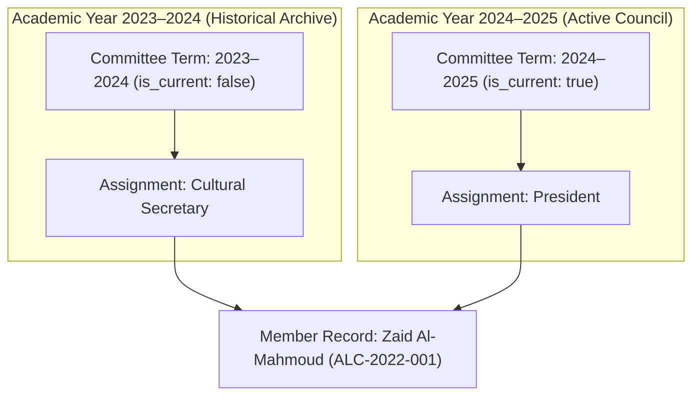

# DATABASE & MIGRATIONS SPECIFICATION
## Arabic Language & Cultural Club Platform

### 1. Database Architecture Overview
The platform's persistence layer is engineered with Drizzle ORM and a normalized relational data model consisting of 21 tables. It provides zero-friction local development via SQLite with WAL mode, while maintaining 100% dialect and architectural compatibility with PostgreSQL (Supabase) for production.

---

### 2. Implemented Schema Entities & Descriptions

| Entity Name | Table Name | Purpose | Key Constraints & Indexes |
| :--- | :--- | :--- | :--- |
| **Site Settings** | `site_settings` | Global branding, contact emails, theme defaults | `key` UNIQUE |
| **Users** | `users` | Admin accounts with granular role permissions | `email` UNIQUE, index on `role` |
| **Members** | `members` | Member directory, bio, internal contact info | `membership_id` UNIQUE, index on `status`, `is_public` |
| **Membership Applications** | `membership_applications` | Prospective applicant queue with reviewer notes | `reference_no` UNIQUE, FK to `users` |
| **Founders** | `founders` | Historical founding members and conveners | Index on `sort_order`, `is_published` |
| **Committee Terms** | `committee_terms` | Academic years (e.g. 2024-2025) and term statuses | `academic_year` UNIQUE, index on `is_current` |
| **Committee Positions** | `committee_positions` | Reusable position titles (President, Secretary, etc.) | `title_en` UNIQUE, `default_rank` |
| **Committee Assignments** | `committee_assignments` | Junction connecting members to specific terms | FK to `committee_terms` & `members`, index on `rank_order` |
| **Events** | `events` | Calendar workshops, competitions, seminars | `slug` UNIQUE, index on `status`, `start_time` |
| **Event Registrations** | `event_registrations` | Public registration records and attendance | FK to `events`, composite index `(email, event_id)` |
| **Annual Plans** | `annual_plans` | 12-month program agenda (Months 1–12) | Composite index `(academic_year, month_number)` |
| **Announcements** | `announcements` | Official notices and press releases | `slug` UNIQUE, index on `is_published`, `is_pinned` |
| **Gallery Albums** | `gallery_albums` | Photo albums categorized by year/activity | `slug` UNIQUE, index on `academic_year`, `is_published` |
| **Media Assets** | `media_assets` | Photos inside albums with dimensions & captions | FK to `gallery_albums`, index on `sort_order` |
| **Learning Resources** | `learning_resources` | Arabic grammar, vocabulary, and reading guides | `slug` UNIQUE, index on `category`, `skill_level` |
| **Achievements** | `achievements` | Institutional awards and competition honors | Index on `is_published` |
| **Publications** | `publications` | Annual magazines and newsletter downloads | `slug` UNIQUE, index on `publication_type` |
| **Editable Pages** | `editable_pages` | Dynamic CMS page definitions (`home`, `about`, etc.) | `slug` UNIQUE |
| **Page Sections** | `page_sections` | Content blocks inside pages | FK to `editable_pages`, index on `section_key` |
| **Audit Logs** | `audit_logs` | Immutable audit log of administrative operations | FK to `users`, index on `action`, `created_at` |
| **Consent Records** | `consent_records` | Data protection and photo publication consent | Index on `(subject_type, subject_id)` |

---

### 3. Historical Committee Preservation Mechanism

One of the platform's core differentiators is the **indestructible preservation of institutional memory**.



- When leadership transitions occur, the outgoing committee term's `is_current` is updated to `false`.
- A new term is created (`is_current: true`) and new assignments are created.
- **Zero data is overwritten or erased**. A member can serve as Secretary in Year 1 and President in Year 2, and both historical records remain permanently queryable by academic year.

---

### 4. Public vs. Private Data Isolation

To prevent unintentional data leakage, the query layer (`src/lib/db/queries.ts`) enforces strict projection boundaries:
- **Public Queries (`getPublicMembers`)**:
  - `SELECT id, membership_id, full_name_en, full_name_ar, photo_url, bio_en, bio_ar, joined_at`
  - Explicitly filters `WHERE is_public = true AND status = 'active'`.
  - **Excludes**: `email`, `phone`, `student_id`.
- **Public Registrations & Applications**:
  - Public users can only submit data; they cannot query or browse other applicants' records.
  - Reviewer notes and administrative statuses are only accessible via authenticated admin procedures.

---

### 5. Migration & Reproducibility Guide

#### Generating New Migrations
```bash
pnpm drizzle-kit generate
```

#### Running Migrations (Non-Interactive & CI/CD Safe)
```bash
pnpm tsx src/lib/db/migrate.ts
```

#### Seeding Test Fixtures (Clearly Tagged `[DEMO FIXTURES]`)
```bash
pnpm tsx src/lib/db/seed.ts
```

#### Executing Automated Verification Suite
```bash
pnpm tsx src/lib/db/test-db.ts
```
