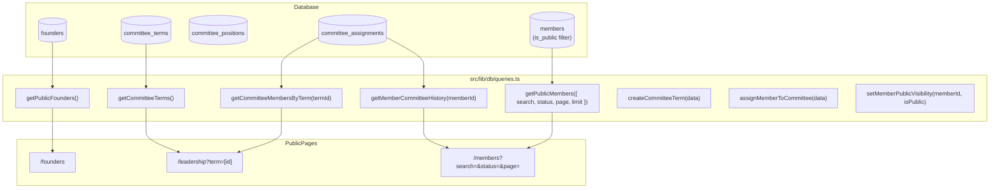

# TECHNICAL ARCHITECTURE PLAN: 007 - Founders, Committee & Member Directory

## 1. Architecture Overview
This plan establishes the data operations, administrative mutations, and public view components for Founders, Committee Terms, and the Member Directory.

---

## 2. Data Operations Specification

### Term Management with Historical Preservation
- `createCommitteeTerm(data)`:
  - Validates `startDate <= endDate` (if `endDate` exists).
  - If `data.isCurrent === true`, executes in a transaction unsetting `isCurrent = false` on all existing terms before inserting the new term.
  - Ensures previous terms and their assignments are never deleted or modified.

### Multi-Term Member Assignments
- `assignMemberToCommittee(data)`:
  - Links `memberId` to `termId` with `positionTitleEn`, `positionTitleAr`, `rankOrder`, and `roleDescription`.
  - Same member can have entries across multiple terms without conflict.
- `getMemberCommitteeHistory(memberId)`:
  - Returns array of `{ termAcademicYear, positionTitleEn, isCurrent }`.

### Privacy-Preserving Member Directory
- `getPublicMembers(params)`:
  - SQL query strictly includes `where(and(eq(members.isPublic, true), eq(members.status, "active")))`.
  - Excludes `email`, `phone`, `studentId`, and internal reviewer notes from the projected columns.

---

## 3. Public Pages Enhancement

### A. `/founders` (`src/app/(public)/founders/page.tsx`)
- Header with institutional breadcrumbs (`Home > About > Founders`).
- Founding story narrative banner and charter citation.
- Responsive grid of founder cards with:
  - Approved portrait or refined neutral monogram fallback (initials + antique brass border).
  - English & Arabic names.
  - Role title, founding year badge, and biography.
  - Archival verification badge.
- Dignified EmptyState fallback.
- Cross-links to `/about` and `/leadership`.

### B. `/leadership` (`src/app/(public)/leadership/page.tsx`)
- Header with breadcrumbs (`Home > About > Leadership & Committees`).
- Dynamic Academic Term Selector:
  - Distinct badges for `Active Term (الحالي)` and `Historical Archive (سابق)`.
  - Term dates and executive summary.
- Executive Roster sorted by `rankOrder ASC` (President, Vice President, Secretaries, Advisors):
  - Officer cards with portrait or initials fallback.
  - English & Arabic position titles.
  - Multi-term service badge if the officer served in other terms.
  - Role description and verified membership ID.
- Dignified EmptyState for terms undergoing archival compilation.
- Cross-links to `/founders` and `/members`.

### C. `/members` (`src/app/(public)/members/page.tsx`)
- Header with breadcrumbs (`Home > Directory`).
- Search and filter bar (search by name, Arabic name, or membership ID).
- Privacy Guarantee Notice banner.
- Member cards with:
  - Portrait or neutral monogram fallback.
  - Full English & Arabic names.
  - Membership ID badge (e.g. `ALC-2024-001`).
  - Active fellow status badge.
  - Committee service tags (e.g. `Executive Council 2024–2025`).
- Accessible pagination controls.
- EmptyState for no search matches.

---

## 4. Verification & Testing Strategy
1. Automated test script `src/lib/db/test-founders-leadership-members.ts`:
   - Test 1: Historical preservation: creating new current term preserves former terms.
   - Test 2: Multi-term service: member assigned to multiple terms correctly retrieved in both.
   - Test 3: Privacy test: private members (`isPublic: false`) and private fields (phone, email, studentId) never appear in public projection.
   - Test 4: Term date validation: rejecting inverted date ranges.
2. Production build verification: `pnpm next build` exits with code 0.
