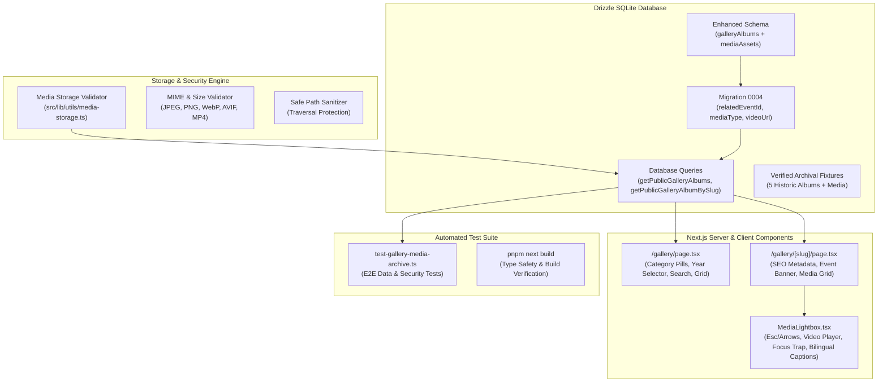

# IMPLEMENTATION PLAN: 011 - Photo & Media Gallery and Archive System

## 1. Technical Architecture & Component Hierarchy

---

## 2. Phase-by-Phase Execution Steps

### Phase A: Schema Enhancement & SQLite Migration
- Add `relatedEventId`, `photographerCredit`, and `location` to `galleryAlbums` in `src/lib/db/schema.ts`.
- Add `mediaType` (`image` or `video`) and `videoUrl` to `mediaAssets` in `src/lib/db/schema.ts`.
- Create migration script `src/lib/db/migrations/0004_gallery_enhancements.sql`.
- Run migration runner `pnpm exec tsx src/lib/db/migrate.ts`.

### Phase B: Media Storage & Security Validator
- Create `src/lib/utils/media-storage.ts`:
  - `validateMediaUpload(file: { mimeType: string; sizeBytes: number; filename: string })`
  - `generateSafeStoragePath(albumSlug: string, filename: string)`
  - `verifyPublicMediaConsent(asset: { isPublished: boolean; albumPublished: boolean })`
  - Zero storage secret leak guarantees.

### Phase C: Data Queries & Admin Operations
- In `src/lib/db/queries.ts`:
  - Update `getPublicGalleryAlbums`: add category, year, and search filtering, plus join with `events` and aggregate photo counts.
  - Update `getPublicGalleryAlbumBySlug`: left join with `events` to get related event details, query published `mediaAssets` sorted by `sortOrder`.
  - Add `getPublicGalleryYears` and `getPublicGalleryCategories`.
  - Add admin functions: `createGalleryAlbum`, `updateGalleryAlbum`, `deleteGalleryAlbum`, `createMediaAsset`, `updateMediaAsset`, `deleteMediaAsset`.

### Phase D: Database Seeding
- In `src/lib/db/seed.ts`:
  - Seed 5 verified public albums across categories (`debates`, `calligraphy`, `symposia`, `workshops`, `ceremonies`) linked to real seeded events.
  - Seed high-resolution image assets with bilingual captions and photographer credits.
  - Seed 1 video media asset to test video playback.
  - Seed 1 unpublished album with media assets to test draft security boundary.
  - Re-run seed script: `pnpm exec tsx src/lib/db/seed.ts`.

### Phase E: Interactive Lightbox & Upgraded UI
- Create `src/app/(public)/gallery/[slug]/MediaLightbox.tsx`:
  - Keyboard listener: `Escape`, `ArrowLeft`, `ArrowRight`.
  - Fullscreen overlay with dark translucent backdrop (`bg-black/90`).
  - Support image zoom/display and HTML5 video player.
  - Caption drawer with title, Arabic calligraphy, date, photographer credit, and counter indicator.
- Refactor `src/app/(public)/gallery/page.tsx`:
  - Interactive search bar and category filter tabs.
  - Academic year dropdown selector.
  - Rich institutional album cards with media count badge and event connection badge.
  - Refined empty states for empty search results.
- Refactor `src/app/(public)/gallery/[slug]/page.tsx`:
  - Link to parent `/gallery`.
  - Associated event alert banner with link to `/events/[slug]`.
  - Media asset grid with thumbnail, video indicator, and click-to-lightbox trigger.
  - Metadata generator `generateMetadata`.

### Phase F: Automated Test Suite & Build Verification
- Write `src/lib/db/test-gallery-media-archive.ts`.
- Run tests via `pnpm exec tsx src/lib/db/test-gallery-media-archive.ts`.
- Verify production build `pnpm exec next build`.
- Update requirements checklist and phase status.
