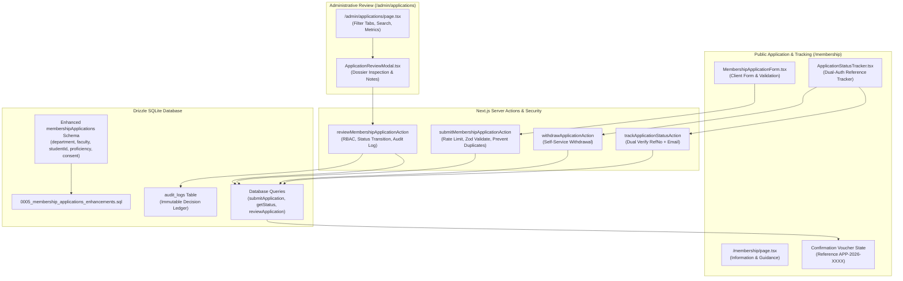

# IMPLEMENTATION PLAN: 012 - Membership Application & Admissions Workflow

## 1. Technical Architecture & Component Flow

---

## 2. Phase-by-Phase Execution Plan

### Phase A: Schema Enhancement & SQLite Migration
- Add missing institutional fields to `membershipApplications` in `src/lib/db/schema.ts`:
  - `applicantNameAr: text("applicant_name_ar")`
  - `studentId: text("student_id")`
  - `department: text("department")`
  - `faculty: text("faculty")`
  - `academicLevel: text("academic_level")`
  - `arabicProficiency: text("arabic_proficiency", { enum: ["beginner", "intermediate", "advanced", "native"] }).default("intermediate")`
  - `consentAgreed: integer("consent_agreed", { mode: "boolean" }).notNull().default(true)`
  - `directoryConsent: integer("directory_consent", { mode: "boolean" }).notNull().default(false)`
  - `reviewedAt: integer("reviewed_at", { mode: "timestamp" })`
- Write migration script `src/lib/db/migrations/0005_membership_applications_enhancements.sql`.
- Run migration runner `pnpm exec tsx src/lib/db/migrate.ts`.

### Phase B: Server Actions & Query Layer
- In `src/lib/actions/membership-application.ts`:
  - Define Zod schemas for application submission, status tracking, and review.
  - Implement IP rate limiting using sliding-window rate limiter.
  - Implement duplicate check on email and studentId.
  - Implement reference generator `APP-2026-XXXX`.
  - Implement `submitMembershipApplicationAction`.
  - Implement `trackApplicationStatusAction` (dual check: referenceNo + email).
  - Implement `withdrawApplicationAction`.
  - Implement `reviewMembershipApplicationAction` (requires `assertPermission("admissions:review")` and logs to `audit_logs`).
- In `src/lib/db/queries.ts`:
  - `submitMembershipApplication(data)`
  - `getMembershipApplicationStatus(referenceNo, email)`
  - `withdrawMembershipApplication(referenceNo, email)`
  - `reviewMembershipApplication(id, reviewerId, status, notes)`
  - Enhance `getAdminMembershipApplications(status, search)`

### Phase C: Public Application & Tracker UI
- Create `src/app/(public)/membership/MembershipApplicationForm.tsx` (Client component):
  - Bilingual personal identity, academic identity, contact coordinates, Arabic proficiency selector, motivation textarea, and consent checkboxes.
  - Live validation errors, pending state, and transition to confirmation state.
- Create `src/app/(public)/membership/ApplicationStatusTracker.tsx` (Client component):
  - Form requiring Reference Number AND Email.
  - Returns card showing status badge, submission date, review stage, and withdrawal button if pending.
- Refactor `src/app/(public)/membership/page.tsx`:
  - Institutional overview, eligibility, privileges, application form, and status tracker tabs.

### Phase D: Administrative Review Queue
- Upgrade `src/app/admin/applications/page.tsx`:
  - Status tabs (`pending`, `under_review`, `approved`, `rejected`, `withdrawn`, `all`).
  - Search input.
  - Create `src/app/admin/applications/ApplicationReviewModal.tsx` for dossier inspection, reviewer notes, and decision buttons (Approve, Reject, Put Under Review).

### Phase E: Automated Verification Test Suite
- Write `src/lib/db/test-membership-application-workflow.ts`:
  - Test valid submission.
  - Test invalid submission validation errors.
  - Test duplicate prevention.
  - Test dual-verification status check.
  - Test non-matched status check (returns null).
  - Test withdrawal workflow.
  - Test admin review status transitions and audit log generation.
  - Test rate limiting.
- Run tests until 100% pass.
- Run `pnpm exec next build`.
- Update checklist and phase status.
